# Review gallery: before and after

Before shots come from `main` at c78dcff on the dev server; after shots from the production build of `design/split-stage-ux` (`next build && next start`). Both at 1280×800 and 390×844, the fold only, taken with the same script. The critique rounds for the homepage are in [home.md](home.md).

| Screen | Before | After |
| --- | --- | --- |
| Home, desktop |  | 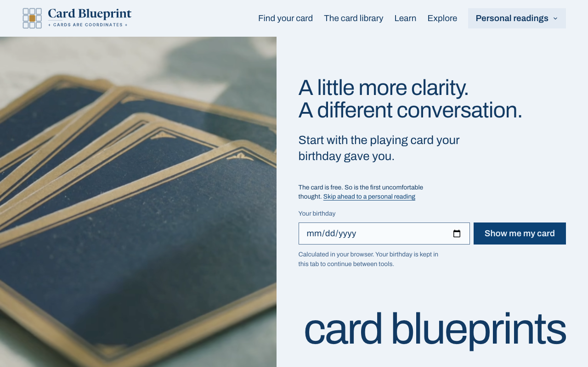 |
| Home, after a birthday | | 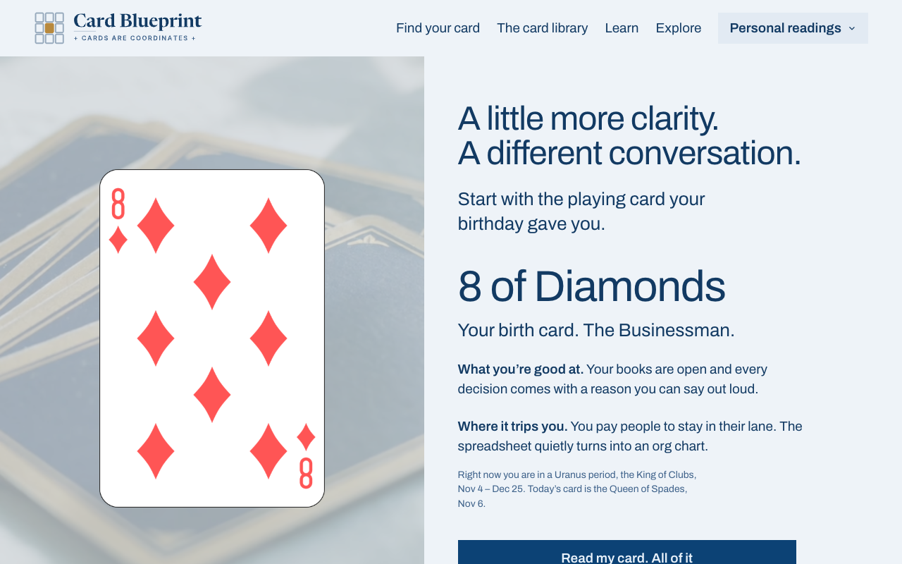 |
| Home, phone |  | 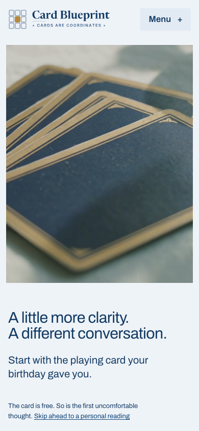 |
| Home, phone, after a birthday | | 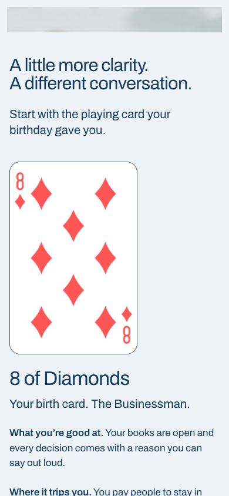 |
| Calculator, desktop | 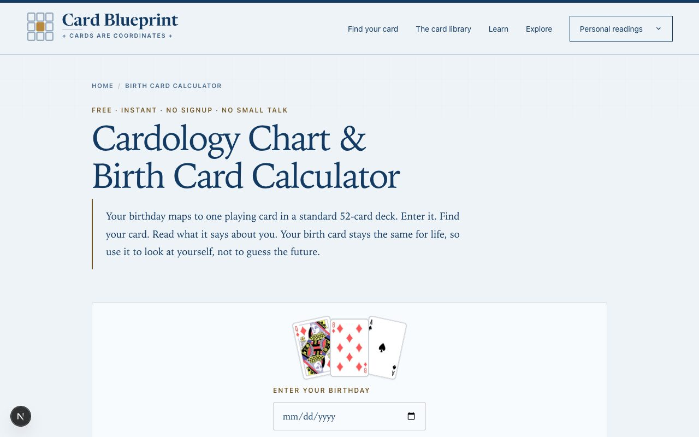 | 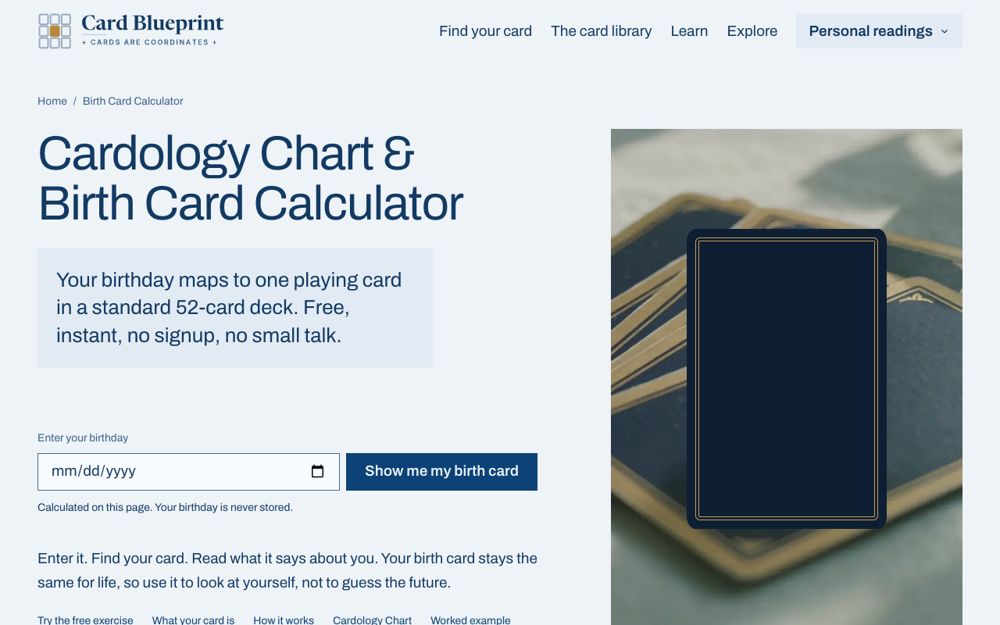 |
| Calculator, after a birthday | | 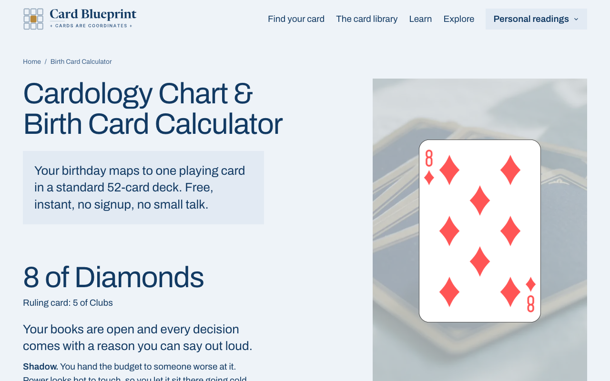 |
| Calculator, phone | 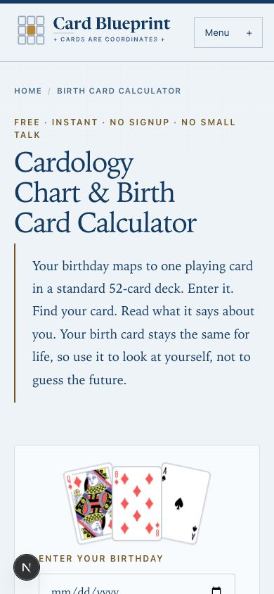 | 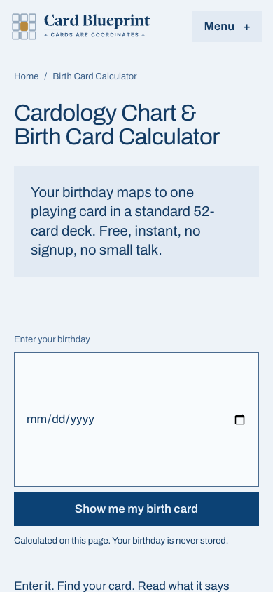 |
| Card page, desktop | 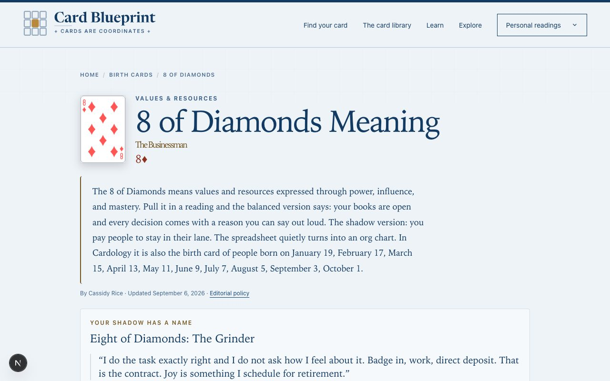 | 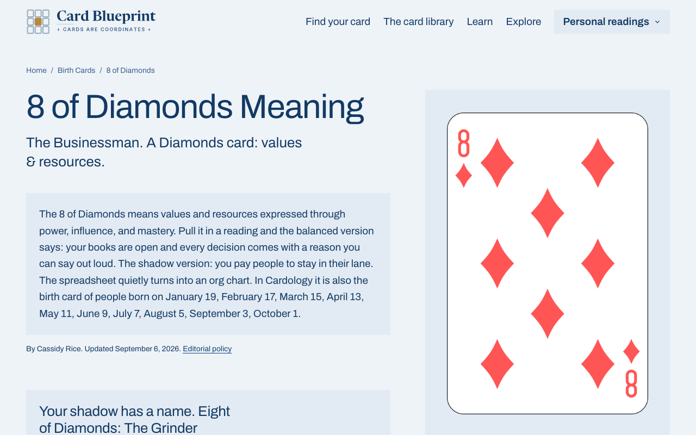 |
| Card page, phone | 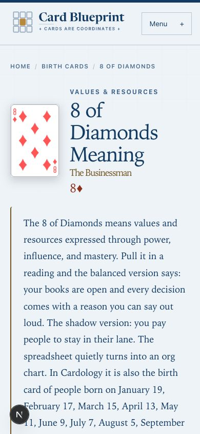 | 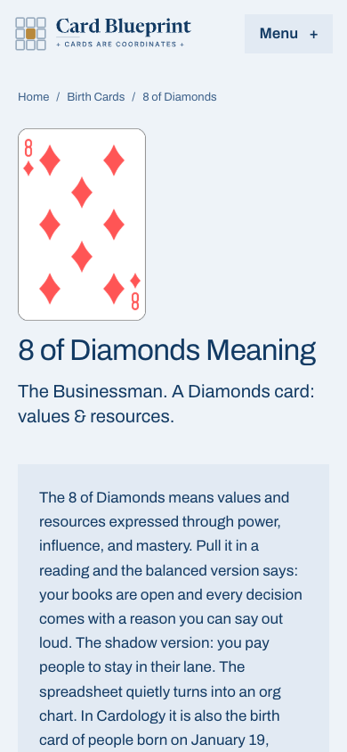 |
| Card library | | 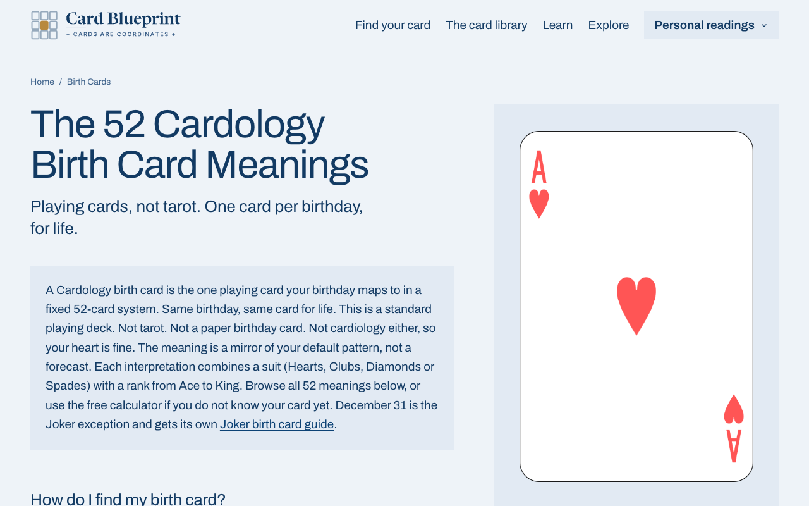 |
| Card of the day | 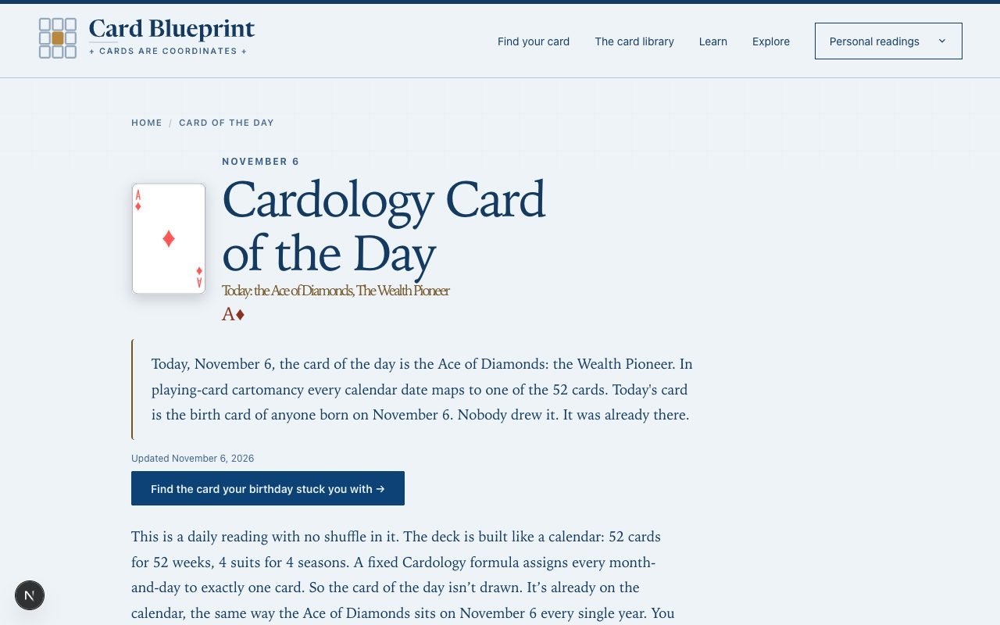 | 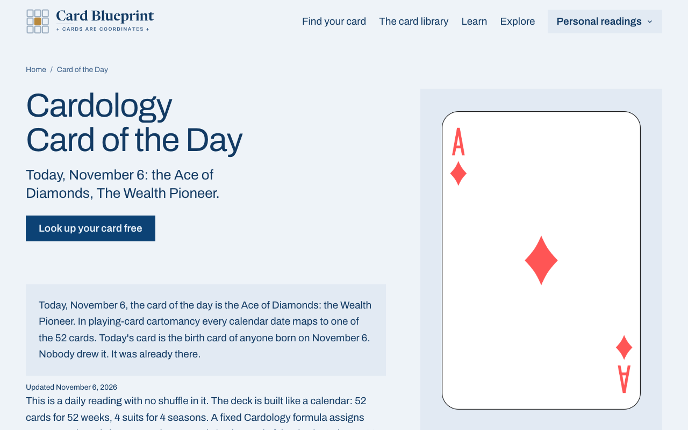 |
| Compatibility calculator | | 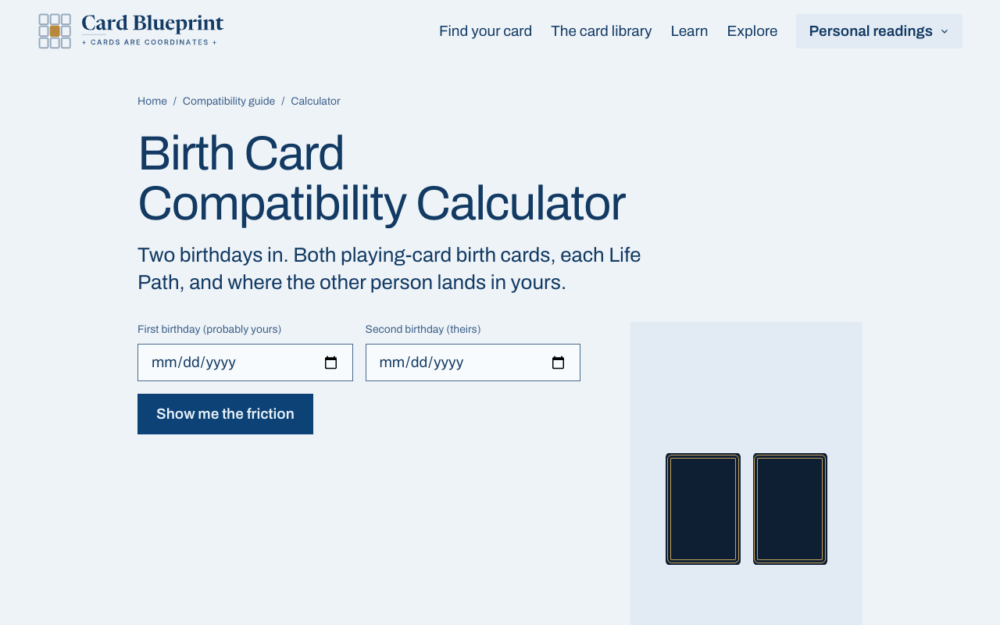 |
| Born on (Worker-ported shell) | | 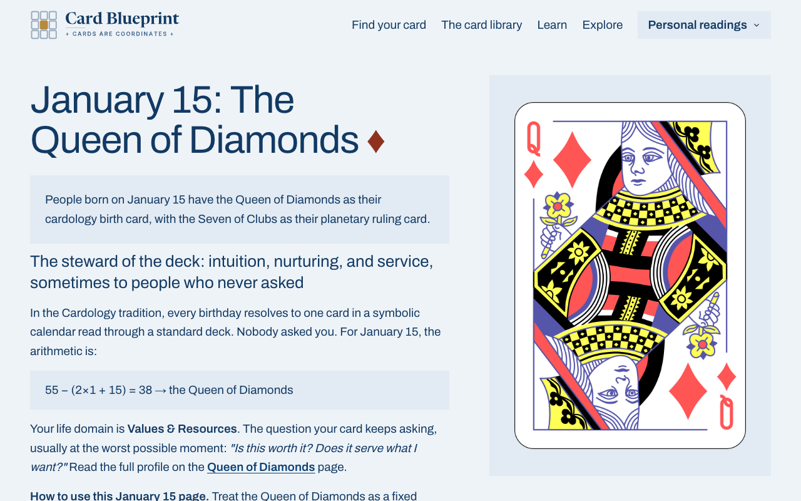 |
| 404 | | 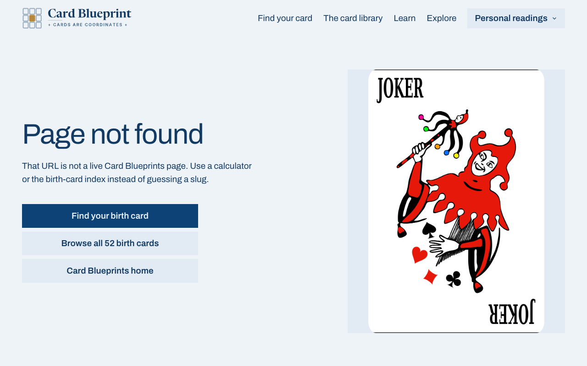 |

## Lighthouse, mobile emulation, production build, 2026-11-07

| Route | Performance | Accessibility | Best practices | SEO | LCP | CLS | TBT |
| --- | --- | --- | --- | --- | --- | --- | --- |
| / | 94 | 100 | 100 | 100 | 3.0 s | 0 | 0 ms |
| /birth-card-calculator | 100 | 100 | 100 | 100 | 1.2 s | 0 | 0 ms |
| /birth-card/8-of-diamonds | 98 | 100 | 100 | 100 | 2.5 s | 0 | 0 ms |
| /card-of-the-day | 100 | 100 | 100 | 92 | 1.2 s | 0 | 10 ms |
| /birth-card-compatibility-calculator | 100 | 100 | 100 | 100 | 0.9 s | 0 | 0 ms |

The homepage LCP element is the header lockup SVG; the stage film starts after the page is idle and the verdict code loads on demand. The one accessibility finding left in that run (the footer mast's accessible name) is fixed in the following commit. The /card-of-the-day SEO 92 is Lighthouse missing the meta description on an edge-rendered response; the tag is in the HTML (`curl` confirms it). INP is not measurable in a lab run; TBT is 0–10 ms everywhere.

## Gates

- tasteskill inspector (`inspect.mjs`, 1920/1280/768/390): homepage 0 FAIL 0 WARN. The reading pages carry the direction's structural findings by design (a picture pinned to one edge, a prose measure capped at 64ch), recorded per screen in the PR.
- Hallmark `sloplint --render`: 0 FAIL on every screen; waivers and answers are the stamp lines at the top of `app/tokens.css`, `app/calculator.css`, `app/card-pages.css`, `app/compat.css`, `app/card-of-the-day/daily.css` and `app/born-on/born-on.css`.
- `bun run test`: green (315 tests). `bun x tsc --noEmit`: clean.
- `bun run test:seo:browser` cannot pass on `main` or this branch: it looks for a "Reveal my birth card" button and a "Not your birthday? Change it" control that `main` already labels "Show me my birth card" and "Wrong birthday? Change it". Left as found and reported.
